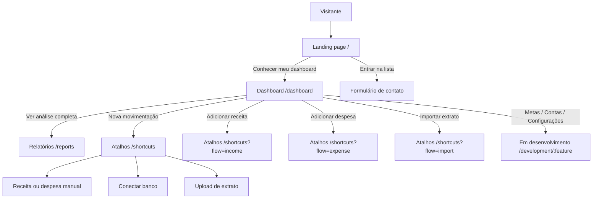

# Ema, Ema, Ema — Documentação do Projeto

**Versão do documento:** 1.0  
**Data:** 06 de novembro de 2026  
**Status do produto:** MVP inicial em construção  
**Stack atual:** Flask, Jinja2, HTML, CSS e JavaScript vanilla

---

## 1. Sobre este documento

Este documento descreve o projeto Ema, Ema, Ema em seu estágio atual. Ele apresenta o objetivo do produto, o escopo do MVP inicial, as telas já construídas, a estrutura técnica, as rotas existentes, a jornada esperada do usuário, as limitações conhecidas e os próximos passos necessários para transformar o protótipo em uma aplicação financeira real.

O documento deve ser lido como uma fotografia do projeto neste momento. O Ema, Ema, Ema ainda está em fase inicial de construção. Portanto, diversas decisões ainda poderão mudar, incluindo o front-end, a identidade visual, a arquitetura de backend, o modelo de dados, o processo de autenticação e a forma de integração com bancos e fontes externas.

---

## 2. Resumo executivo

O Ema, Ema, Ema é uma aplicação de gestão financeira pessoal criada para ajudar pessoas a entenderem melhor o que entra, o que sai e o que está previsto para sair de suas contas. A proposta é transformar dados financeiros dispersos em uma experiência visual simples, clara e acionável.

A primeira versão do MVP prioriza a experiência de uso e a validação da estrutura do produto. Ela apresenta uma landing page pública, um dashboard financeiro, uma área de relatórios detalhados e uma central de atalhos para adicionar movimentações e importar extratos.

Neste momento, o sistema apresenta dados demonstrativos e interações de front-end. Ele ainda não realiza análise real de dados bancários, não possui autenticação de usuários, não persiste movimentações em um banco de dados e não mantém conexões bancárias reais. Essas capacidades fazem parte das próximas etapas de desenvolvimento.

### 2.1. Objetivo principal

Criar uma plataforma de gestão financeira pessoal que permita ao usuário:

- Visualizar sua situação financeira em uma visão geral objetiva.
- Registrar receitas, despesas e compromissos.
- Importar movimentações por conexão bancária ou arquivo.
- Identificar padrões de consumo e categorias que merecem atenção.
- Acompanhar relatórios, alertas e oportunidades de melhoria.
- Tomar decisões financeiras com mais clareza e menos esforço manual.

### 2.2. Posicionamento inicial

O Ema, Ema, Ema pretende ser uma camada de clareza entre a pessoa e os seus dados financeiros. A aplicação não deve ser apenas uma tabela de lançamentos. Ela deve ajudar o usuário a perceber o significado dos dados, entender tendências e agir antes que um problema financeiro aconteça.

A identidade verbal inicial resume essa intenção na frase:

> **cada um com seu problema... Não, estamos com você.**

---

## 3. Fase atual: MVP inicial

O projeto está no estágio de MVP inicial. Isso significa que a prioridade atual é validar a proposta, a organização das telas, a linguagem visual e os principais fluxos de navegação antes de construir toda a infraestrutura de produção.

O MVP atual deve ser entendido como uma base de experimentação e alinhamento. Ele já permite demonstrar como o produto poderá funcionar, mas ainda não deve ser utilizado como uma plataforma financeira pronta para uso real.

### 3.1. O que o MVP já demonstra

O MVP demonstra quatro experiências principais:

1. **Apresentação do produto:** uma landing page com posicionamento, benefícios, prévia visual e formulário de interesse.
2. **Visão geral financeira:** um dashboard com saldo, receitas, despesas, taxa de economia, fluxo de caixa, categorias e transações.
3. **Análise detalhada:** uma página de relatórios com alertas, evolução dos gastos, composição por categoria e serviços pagos ou pendentes.
4. **Ações operacionais:** uma central para adicionar receitas, adicionar despesas e importar extratos por diferentes caminhos.

### 3.2. O que ainda é provisório

Os seguintes elementos ainda são demonstrativos ou estão sujeitos a mudança:

- Dados financeiros exibidos nas telas.
- Nome e perfil de usuário usados na demonstração.
- Valores de saldo, receitas, despesas e categorias.
- Histórico de transações e importações.
- Lista de bancos disponíveis para conexão.
- Mensagens de sucesso e estados de integração.
- Identidade visual, espaçamentos, componentes e textos.
- Estrutura final de navegação e nomenclatura das áreas.
- Processo de cadastro e armazenamento das informações de contato.

---

## 4. Escopo já implementado

### 4.1. Landing page pública

A landing page está disponível na rota `/`. Ela é a porta de entrada do projeto e foi construída para apresentar o Ema, Ema, Ema a visitantes antes do acesso à área interna.

A página contém:

- Logotipo e navegação de apresentação.
- Headline principal: “Ema, Ema, Ema. Estamos com você.”
- Texto de posicionamento do produto.
- CTA para acessar o dashboard.
- Link para acompanhar o lançamento.
- Prévia visual do dashboard construída com HTML e CSS.
- Indicadores visuais de clareza, alertas e organização.
- Bloco de benefícios do produto.
- Formulário de lista de contato.
- Rodapé com acesso ao dashboard.

O formulário de interesse solicita:

- Nome completo.
- E-mail.
- CPF.
- Idade.
- Consentimento para receber atualizações.

Atualmente, o formulário possui validação nativa do navegador, máscara de CPF, mensagem de confirmação e armazenamento demonstrativo em `localStorage`. Ele ainda não envia os dados para uma API nem para um banco de dados.

Como o CPF é um dado pessoal sensível do ponto de vista de privacidade e segurança operacional, a implementação atual não deve ser considerada adequada para produção. Antes de coletar esse dado em um ambiente real, será necessário revisar a necessidade, a base legal, o consentimento, a política de privacidade, a retenção e a segurança do armazenamento.

### 4.2. Dashboard financeiro

O dashboard está disponível na rota `/dashboard`. Ele é o centro da experiência interna do Ema, Ema, Ema.

A tela apresenta:

- Saldo disponível.
- Receitas do período.
- Despesas do período.
- Taxa de economia.
- Fluxo de caixa.
- Evolução financeira mensal.
- Distribuição de gastos por categoria.
- Transações recentes.
- Ações rápidas.
- Navegação para relatórios e atalhos.

O dashboard utiliza uma composição baseada em cartões, painéis e gráficos com fundo claro, bordas sutis, cantos arredondados e destaque verde-lima. A intenção é apresentar uma interface profissional e leve, sem excesso de ruído visual.

As ações rápidas do dashboard direcionam o usuário para a central de atalhos com o fluxo correspondente pré-selecionado:

- `?flow=income` para adicionar receita.
- `?flow=expense` para adicionar despesa.
- `?flow=import` para importar extrato.

### 4.3. Relatórios detalhados

A página de relatórios está disponível na rota `/reports`.

Ela foi criada para ser diferente do dashboard inicial. Enquanto o dashboard prioriza uma visão geral, o relatório prioriza investigação e acompanhamento de compromissos.

A página apresenta:

- Alertas financeiros no topo.
- Indicadores de despesas no período.
- Serviços pagos.
- Serviços a pagar.
- Média diária de gastos.
- Gráfico compacto de despesas semanais.
- Gráfico de linha preenchida para evolução dos gastos.
- Alternância entre visão mensal e semanal.
- Composição dos gastos por categoria.
- Tabela de serviços pagos e pendentes.
- Filtro por status.
- Filtro por categoria.
- Busca textual por serviço.
- Área de gastos recorrentes e pontos de atenção.

A substituição do gráfico de barras pelo gráfico de linha preenchida foi feita para melhorar a leitura da tendência e reduzir linhas auxiliares desnecessárias. A página também recebeu filtros combináveis para facilitar a segmentação dos compromissos.

### 4.4. Central de atalhos

A central de atalhos está disponível na rota `/shortcuts`.

Ela concentra as operações que devem ser mais frequentes para o usuário:

- Adicionar receita.
- Adicionar despesa.
- Importar extrato.

O formulário demonstrativo de lançamento manual contém:

- Tipo de movimentação.
- Descrição.
- Valor.
- Data.
- Categoria.
- Conta de destino.
- Opção de recorrência.
- Observação.

A importação possui dois caminhos de interface:

1. **Conectar banco:** exibe instituições bancárias demonstrativas e botões de conexão.
2. **Enviar arquivo:** aceita visualmente arquivos OFX, CSV, QIF ou PDF, com área de arrastar e soltar.

Também são exibidos exemplos de contas conectadas e histórico recente de importações. Esses dados ainda são demonstrativos e não representam conexões ou importações reais.

---

## 5. Estrutura técnica atual

O projeto utiliza uma estrutura simples, adequada ao estágio inicial do MVP.

```text
finboard/
├── app.py
├── app.config.ts
├── requirements.txt
├── TODO.md
├── public/
│   └── manus-routes.json
├── static/
│   ├── brand-mark.svg
│   ├── css/
│   │   ├── dashboard.css
│   │   ├── landing.css
│   │   ├── reports.css
│   │   └── shortcuts.css
│   └── js/
│       ├── dashboard.js
│       ├── landing.js
│       ├── reports.js
│       └── shortcuts.js
└── templates/
    ├── dashboard.html
    ├── landing.html
    ├── reports.html
    └── shortcuts.html
```

### 5.1. `app.py`

É o ponto de entrada da aplicação Flask. Atualmente ele:

- Inicializa a aplicação.
- Define os diretórios de templates e arquivos estáticos.
- Registra as rotas públicas e internas.
- Passa dados demonstrativos para os templates Jinja.
- Serve o manifesto público de rotas.
- Inicia o servidor na porta definida por `PORT`, usando `3000` como padrão.

O arquivo ainda concentra os dados de demonstração diretamente no código. Em uma próxima fase, esses dados deverão ser substituídos por serviços, modelos e repositórios persistentes.

### 5.2. `templates/`

Cada tela principal possui seu próprio arquivo HTML, como solicitado para o projeto:

- `landing.html`: página pública inicial.
- `dashboard.html`: visão geral financeira.
- `reports.html`: relatório detalhado.
- `shortcuts.html`: central de atalhos.

Os templates usam Jinja2 para receber informações do Flask. A estrutura está preparada para que valores demonstrativos sejam substituídos por dados reais no futuro.

### 5.3. `static/css/`

Os estilos são separados por contexto de tela:

- `dashboard.css`: tokens visuais globais e estilos do dashboard.
- `landing.css`: apresentação pública, prévia do produto e formulário de contato.
- `reports.css`: gráficos, alertas, filtros e tabela de relatórios.
- `shortcuts.css`: formulário de lançamentos, bancos e importação.

A identidade atual utiliza:

- Fundo cinza muito claro.
- Superfícies brancas.
- Preto profundo para contraste.
- Verde-lima como cor de ação e destaque.
- Tons suaves de verde, laranja, vermelho e roxo para categorias e estados.
- Tipografia `DM Sans` para interface e `Manrope` para títulos e marca.

### 5.4. `static/js/`

Os comportamentos de cada tela também estão separados:

- `landing.js`: máscara de CPF, validação, feedback, armazenamento local demonstrativo e animações de entrada.
- `dashboard.js`: menu responsivo, modal e interações da visão geral.
- `reports.js`: filtros, alternância de gráficos, busca e ações do relatório.
- `shortcuts.js`: alternância entre receita e despesa, abas de importação, conexão demonstrativa e seleção de arquivo.

A implementação atual usa JavaScript vanilla, sem framework de interface. Isso mantém o MVP simples e facilita a futura decisão sobre uma camada de front-end mais estruturada.

### 5.5. `public/manus-routes.json`

O manifesto declara as páginas navegáveis do projeto:

| Rota | Título | Finalidade |
|---|---|---|
| `/` | Ema, Ema, Ema — cada um com seu problema... Não, estamos com você. | Landing page pública |
| `/dashboard` | Dashboard \| Ema, Ema, Ema | Visão geral financeira |
| `/shortcuts` | Atalhos \| Ema, Ema, Ema | Lançamentos e importação |
| `/reports` | Relatórios \| Ema, Ema, Ema | Análise detalhada de gastos |
| `/development/:feature` | Em desenvolvimento \| Ema, Ema, Ema | Placeholder para áreas futuras |

### 5.6. `requirements.txt`

A dependência atual é:

```text
Flask==3.1.0
```

A lista deverá crescer quando forem adicionados banco de dados, validação de formulários, autenticação, integração bancária, filas ou serviços de análise.

---

## 6. Rotas e fluxo de navegação

### 6.1. Rotas atuais

#### `GET /`

Renderiza a landing page pública. O objetivo é explicar o produto, captar interessados e direcionar para o dashboard.

#### `GET /dashboard`

Renderiza o dashboard financeiro com dados demonstrativos de usuário, data, saldo, receitas, despesas, gráficos e transações.

#### `GET /reports`

Renderiza o relatório detalhado com dados demonstrativos de serviços, categorias, despesas e indicadores.

#### `GET /shortcuts`

Renderiza a central de atalhos com dados demonstrativos de contas, bancos e importações recentes.

A rota também pode receber parâmetros de consulta para pré-selecionar o fluxo visual:

- `/shortcuts?flow=income`
- `/shortcuts?flow=expense`
- `/shortcuts?flow=import`

#### `GET /development/<feature>`

Renderiza a tela de “Em desenvolvimento” para áreas que ainda não possuem uma página funcional. Nesta etapa, a rota é usada por `goals`, `accounts` e `settings`, correspondentes a Metas, Contas e cartões e Configurações.

Esses itens aparecem na navegação lateral com ícone e texto acinzentados, além do selo “Em breve”. Eles continuam acessíveis para que a pessoa entenda o destino da funcionalidade, mas não simulam uma tela que ainda não existe.

#### `GET /manus-routes.json`

Serve o manifesto de rotas utilizado pelo ambiente do projeto.

### 6.2. Diagrama de rotas



---

## 7. Jornada do usuário

### 7.1. Jornada de descoberta

1. A pessoa acessa `/`.
2. Encontra a mensagem principal do Ema, Ema, Ema e uma prévia do produto.
3. Conhece os benefícios de centralizar a vida financeira.
4. Pode acessar o dashboard para explorar o MVP.
5. Pode preencher o formulário de lista de contato para acompanhar o lançamento.

### 7.2. Jornada de uso do dashboard

1. A pessoa acessa `/dashboard`.
2. Visualiza saldo, receitas, despesas e taxa de economia.
3. Observa o fluxo de caixa e a distribuição de gastos.
4. Consulta as transações recentes.
5. Escolhe entre analisar os gastos em `/reports` ou realizar uma ação em `/shortcuts`.

### 7.3. Jornada de análise

1. A pessoa acessa `/reports` pelo menu ou pelo CTA do dashboard.
2. Visualiza alertas de vencimentos e oportunidades.
3. Compara despesas e serviços pagos ou pendentes.
4. Alterna o período do gráfico de evolução.
5. Filtra os serviços por status, categoria e texto.
6. Identifica categorias que merecem atenção.

### 7.4. Jornada de lançamento manual

1. A pessoa acessa `/shortcuts`.
2. Escolhe adicionar receita ou despesa.
3. Preenche descrição, valor, data, categoria e conta.
4. Opcionalmente marca o lançamento como recorrente.
5. Adiciona uma observação.
6. Envia o formulário.
7. No MVP atual, recebe um feedback demonstrativo; nenhum lançamento é persistido em banco.

### 7.5. Jornada de importação

1. A pessoa acessa a central de atalhos.
2. Escolhe “Conectar banco” ou “Enviar arquivo”.
3. Na conexão bancária, escolhe uma instituição demonstrativa.
4. No upload, seleciona ou arrasta um arquivo OFX, CSV, QIF ou PDF.
5. No produto final, o arquivo ou a conexão deverá passar por validação, leitura, normalização, categorização e confirmação pelo usuário.
6. No MVP atual, a interface apenas simula esses estados.

---

## 8. Estado atual dos dados

Os dados apresentados no projeto são exemplos estáticos passados pelo Flask aos templates. Eles servem para validar layout, hierarquia visual e comportamento de interface.

Atualmente não existe:

- Modelo de usuário.
- Cadastro ou autenticação.
- Banco de dados configurado.
- Conta financeira persistida.
- Transação persistida.
- Integração com Open Finance.
- Parser real de OFX, CSV, QIF ou PDF.
- Motor real de categorização.
- Análise financeira baseada em dados reais.
- Sistema de notificações.
- Administração da lista de contatos.
- API pública ou API interna de movimentações.

A lista de contato da landing page é o único fluxo que possui armazenamento local no navegador, por meio de `localStorage`. Isso é suficiente para demonstração, mas não é uma solução de captação real, confiável ou adequada para produção.

---

## 9. O que falta fazer

### 9.1. Backend e persistência

- Definir a arquitetura de backend além das rotas de renderização.
- Criar banco de dados e migrações.
- Criar modelos para usuários, contatos, contas, transações e importações.
- Criar camada de serviços e repositórios.
- Substituir dados demonstrativos por consultas reais.
- Implementar endpoints para criação e atualização de movimentações.
- Registrar histórico e auditoria das alterações.

### 9.2. Autenticação e contas

- Criar cadastro e login.
- Implementar recuperação de senha.
- Criar sessão segura.
- Separar dados por usuário.
- Implementar permissões e encerramento de sessão.
- Criar tela de perfil e configurações.

### 9.3. Lista de contato

- Criar endpoint de cadastro de interesse.
- Definir armazenamento seguro dos dados.
- Remover o uso de `localStorage` como fonte principal.
- Implementar confirmação de e-mail, se necessário.
- Criar painel administrativo ou integração com uma ferramenta autorizada.
- Documentar política de privacidade e consentimento.
- Rever se CPF e idade são realmente necessários para a finalidade de contato.

### 9.4. Integração bancária

- Definir o provedor de Open Finance ou conexão bancária.
- Implementar OAuth ou fluxo de autorização equivalente.
- Armazenar tokens de forma segura.
- Implementar revogação de consentimento.
- Sincronizar contas e transações.
- Monitorar falhas e expiração de conexões.
- Informar claramente ao usuário quais dados serão acessados.

### 9.5. Importação de arquivos

- Criar upload real com limites de tamanho e tipo.
- Validar extensão, MIME type e conteúdo.
- Implementar parsers para OFX, CSV e QIF.
- Avaliar tratamento de PDF com OCR ou extração estruturada.
- Normalizar datas, valores, descrições e identificadores.
- Detectar duplicidades.
- Permitir revisão antes de confirmar a importação.
- Registrar o lote de importação e seus erros.

### 9.6. Análise real dos dados

- Definir regras de categorização.
- Criar categorias personalizáveis.
- Calcular saldo, fluxo de caixa e taxa de economia com base em transações reais.
- Criar agregações por dia, semana, mês e categoria.
- Identificar recorrências.
- Identificar variações fora do padrão.
- Criar alertas de vencimento.
- Criar relatórios reais e exportáveis.
- Avaliar uso de modelos de IA somente depois de estabelecer dados confiáveis e controles de privacidade.

### 9.7. Front-end e identidade visual

- Revisar a identidade visual com base em testes de usabilidade.
- Definir um design system formal.
- Criar componentes reutilizáveis.
- Padronizar estados de carregamento, erro, vazio e sucesso.
- Melhorar acessibilidade e navegação por teclado.
- Revisar textos e microcopy.
- Adaptar a interface ao comportamento de dados reais.
- Definir se o projeto continuará com templates Flask ou migrará para uma camada de front-end dedicada.

### 9.8. Qualidade, segurança e operação

- Criar testes unitários e de integração.
- Criar testes de formulário e navegação.
- Criar testes de responsividade e acessibilidade.
- Configurar logs estruturados.
- Configurar monitoramento de erros.
- Criar pipeline de CI/CD.
- Definir ambientes de desenvolvimento, homologação e produção.
- Configurar backups e política de recuperação.
- Revisar LGPD e segurança de dados financeiros.
- Executar análise de dependências e vulnerabilidades.

---

## 10. Próximos passos recomendados

A sequência abaixo prioriza validar a fundação antes de avançar para integrações mais sensíveis.

### Fase 1 — Consolidar a base do MVP

1. Revisar a identidade visual e congelar temporariamente os principais tokens.
2. Criar um design system mínimo com botões, campos, cartões, tabelas e estados.
3. Definir a experiência de erro, carregamento e ausência de dados.
4. Corrigir textos e revisar acessibilidade das quatro telas.
5. Criar testes de renderização para todas as rotas.

### Fase 2 — Persistência e lista de contato

1. Ativar banco de dados.
2. Criar tabela de contatos interessados.
3. Criar endpoint seguro para o formulário da landing page.
4. Validar e normalizar nome, e-mail, CPF e idade.
5. Registrar consentimento e data de cadastro.
6. Criar uma forma de exportar ou consultar os interessados.

### Fase 3 — Usuários e dados financeiros

1. Implementar autenticação.
2. Criar isolamento de dados por usuário.
3. Criar contas financeiras e cartões.
4. Criar transações de receita e despesa.
5. Substituir os dados demonstrativos do dashboard por consultas reais.

### Fase 4 — Importação e conexão bancária

1. Implementar upload seguro.
2. Criar importação OFX, CSV e QIF.
3. Criar revisão e confirmação das movimentações.
4. Escolher e integrar um provedor bancário.
5. Implementar sincronização e revogação de consentimento.

### Fase 5 — Análise e evolução do produto

1. Implementar cálculos financeiros reais.
2. Criar categorização e regras personalizáveis.
3. Implementar alertas e recorrências.
4. Melhorar relatórios e filtros.
5. Avaliar recursos inteligentes baseados em padrões dos dados.
6. Validar a experiência com usuários reais.

---

## 11. Requisitos de produção que ainda não estão atendidos

O projeto ainda não deve ser tratado como produto financeiro em produção. Antes de disponibilizar contas reais, é necessário atender pelo menos aos seguintes pontos:

- Autenticação segura.
- Autorização e isolamento entre usuários.
- Criptografia em trânsito e em repouso.
- Gestão segura de segredos e tokens bancários.
- Política de privacidade.
- Consentimento explícito para dados pessoais e bancários.
- Adequação à LGPD.
- Logs e auditoria.
- Tratamento de erros de integração.
- Backup e recuperação.
- Testes automatizados.
- Monitoramento.
- Revisão jurídica e de segurança.
- Definição clara de responsabilidades sobre dados financeiros.

A existência de uma interface de conexão bancária no MVP não significa que a aplicação já esteja conectada a instituições financeiras. Os bancos exibidos atualmente são apenas exemplos visuais.

---

## 12. Como executar localmente

Com Python e Flask instalados:

```bash
cd /home/ubuntu/finboard
python3 -m venv .venv
source .venv/bin/activate
pip install -r requirements.txt
python3 app.py
```

Depois, acessar:

- `http://localhost:3000/` — landing page.
- `http://localhost:3000/dashboard` — dashboard.
- `http://localhost:3000/reports` — relatórios.
- `http://localhost:3000/shortcuts` — atalhos.

Para selecionar outra porta:

```bash
PORT=3001 python3 app.py
```

---

## 13. Decisões de produto registradas

### 13.1. Landing page separada do dashboard

A rota `/` foi reservada para aquisição, apresentação e lista de interesse. O dashboard ficou explicitamente em `/dashboard`, evitando misturar a jornada de descoberta com a jornada de uso do sistema.

### 13.2. Cada tela em seu próprio template

As páginas principais foram separadas em arquivos HTML distintos. Essa decisão mantém o projeto fácil de entender neste estágio e deixa clara a divisão entre landing, dashboard, relatórios e atalhos.

### 13.3. Dados demonstrativos antes da integração real

A prioridade foi criar e validar a experiência visual antes de adicionar a complexidade de conexões bancárias, parsing de extratos e persistência. Isso reduz retrabalho enquanto o produto ainda está sendo definido.

### 13.4. Interface preparada para evolução

Os templates possuem pontos de substituição para variáveis Jinja. As informações demonstrativas poderão ser trocadas por dados vindos de serviços e banco de dados sem que toda a estrutura visual precise ser reconstruída.

### 13.5. Referências visuais

O sistema foi construído a partir da identidade visual já estabelecida para o Ema, Ema, Ema e recebeu como referência adicional a landing page do Pierre Finance: https://lp.pierre.finance/

A referência foi usada para observar a organização de uma landing page de produto financeiro, com hero forte, prova visual do produto, benefícios e CTA. O Ema, Ema, Ema possui composição, textos e componentes próprios.

---

## 14. Glossário

**MVP:** versão mínima viável usada para validar proposta, fluxos e experiência antes da implementação completa.

**Dashboard:** tela de visão geral que reúne os principais indicadores financeiros.

**Relatório:** tela orientada à análise detalhada de gastos, compromissos e categorias.

**Atalhos:** central de ações para lançar receitas, despesas e importar movimentações.

**Open Finance:** modelo de compartilhamento autorizado de dados financeiros entre instituições e serviços habilitados.

**Extrato OFX/CSV/QIF:** formatos possíveis para transportar movimentações financeiras entre sistemas.

**LocalStorage:** armazenamento local do navegador. No MVP, é usado apenas para demonstrar o cadastro da lista de contato.

**Jinja2:** mecanismo de templates utilizado pelo Flask para renderizar HTML com dados do servidor.

---

## 15. Conclusão

O Ema, Ema, Ema já possui uma base visual coerente e quatro experiências principais conectadas: aquisição, visão geral, análise e operação. Essa fundação é suficiente para demonstrar a ideia do produto, validar a organização inicial e iniciar conversas sobre o comportamento esperado da aplicação.

Ao mesmo tempo, o projeto ainda está longe de ser uma plataforma financeira completa. A próxima etapa mais importante não é apenas adicionar novas telas, mas transformar os dados demonstrativos em dados reais com segurança, privacidade, persistência e rastreabilidade.

A evolução recomendada é seguir de forma incremental: consolidar a experiência, criar a persistência da lista de contato, implementar usuários e transações, depois avançar para importação e conexão bancária. A análise financeira real deve ser construída sobre dados confiáveis, regras transparentes e uma base de segurança adequada.


---

## 16. Rebranding e retorno ao estilo visual original

A identidade do produto foi atualizada de **FinBoard** para **Ema, Ema, Ema**. A mudança acompanha a intenção de tornar a marca mais próxima, memorável e humana, usando como referência o trocadilho “ema, ema, ema, cada um com seu problema”.

O slogan oficial passou a ser:

> **cada um com seu problema... Não, estamos com você.**

Após a revisão visual, o projeto retornou ao estilo claro originalmente estabelecido para as telas. A direção atual preserva:

- Fundo cinza muito claro e superfícies brancas.
- Tipografia limpa e hierarquia editorial.
- Cartões com bordas suaves, cantos arredondados e sombras discretas.
- Preto profundo para textos e ações principais.
- Verde-lima como cor de destaque, confirmação e chamadas para ação.
- Tons auxiliares suaves para categorias, alertas e estados financeiros.

O novo nome, slogan, títulos de rota e mensagens da interface foram mantidos. A alteração visual não modifica as rotas nem os fluxos já construídos.
